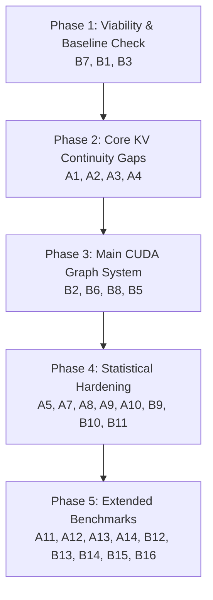

# Master Experiment Run Guide: KV Continuity & Bucketed CUDA Graph Papers

This document provides the definitive, end-to-end operational runbook for executing the complete empirical suite to strengthen:
1. **Paper 1 (KV Continuity):** *KV-Cache Continuity and the Limits of Intermediate Representations in Depth-Truncated Transformers*
2. **Paper 2 (CUDA Graph Systems):** *Zero-Overhead Dynamic Early-Exit Transformer Inference via Bucketed CUDA Graphs*

Every experiment is tied directly to a defended scientific claim, lists pass/fail criteria, exact CLI execution commands for **Kaggle** and **Google Colab** (with single GPU $\le 16\text{ GB}$ VRAM), quick smoke-test commands, and output artifact paths.

---

## Table of Defended Claims

| Claim ID | Paper | Core Claim Statement | Evidence Needed | Corresponding Experiments |
| :---: | :---: | :--- | :--- | :---: |
| **C1** | KV | Native Projection preserves cache utility zero-shot | Beats omission, zero, mean, copy; holds under autoregressive generation | A1, A2, A3, A4, A5 |
| **C2** | KV | Total error splits into attention error and readout error | Joint condition tests additivity: $\mathcal{E}_{\text{joint}} \approx \mathcal{E}_{\text{attn}} + \mathcal{E}_{\text{readout}}$ | A4, A6, A12 |
| **C3** | KV | Values drift substantially faster than Keys | Replicates across depths/architectures; unconfounded by RoPE or bias | A9, A10 |
| **C4** | Graph | Fill preserves quality at shallow bucket depths (33%–83%) | PPL, paired KL, and Top-1 match across buckets $\{4, 6, 8, 10, 12\}$ | B1, B2 |
| **C5** | Graph | Fill overhead is minimal inside captured CUDA graphs | Replay time with vs without fill; fused GEMM optimization | B3, B4, B7, B11 |
| **C6** | Graph | Graph buckets eliminate eager dynamic dispatch tax | Throughput (tok/s) vs eager dynamic, SkipDecode, and baseline | B6, B8, B12 |
| **C7** | Graph | Device routing is sync-free, deterministic, and correct | Profiler trace (no DtoH, no `.item()`); numerical equivalence | B5, B9, B10 |

---

## Suggested Phased Execution Order



---

## Part B: KV Continuity Paper Experiments (A1 – A14)

### Priority P0 (Must Have Before Submission)

#### A1. Cache-Omission Baseline
- **Claim:** C1 (Native Projection beats doing nothing, not just Direct Copy).
- **Pass Criterion:** Native Projection achieves strictly lower $\bar{D}_{\mathrm{KL}}$ than Cache Omission at every depth tested.
- **Script:** `experiments/run_kv_baselines.py`
- **Commands:**
  ```bash
  # Kaggle / Colab (GPU):
  python experiments/run_kv_baselines.py --model-id Qwen/Qwen2.5-3B --depths 18,24,30 --device cuda
  # Smoke test (CPU):
  python experiments/run_kv_baselines.py --quick --device cpu
  ```
- **Output:** `results/canonical_sweeps/kv_baselines/kv_baselines_Qwen_Qwen2.5-3B.csv`

#### A2. Expanded Fill Baselines (Zero, Mean, Prev-Token, Learned Linear)
- **Claim:** C1 (The gain originates specifically from each layer's own projection weights, and training a learned linear fill is unnecessary).
- **Pass Criterion:** Native Projection beats Zero Fill, Running Mean Fill, and Prev-Token Copy; quantifies gap to learned linear projection.
- **Script:** `experiments/run_kv_baselines.py`
- **Commands:**
  ```bash
  # Kaggle / Colab (GPU):
  python experiments/run_kv_baselines.py --model-id meta-llama/Llama-3.2-1B --depths 6,8,10,12 --device cuda
  ```
- **Output:** `results/canonical_sweeps/kv_baselines/kv_baselines_meta-llama_Llama-3.2-1B.csv`

#### A3. Autoregressive (Non-Teacher-Forced) Generation
- **Claim:** C1 (Teacher-forced results survive compounding autoregressive error).
- **Pass Criterion:** Token match rate against full-depth greedy output degrades gracefully with length; reports divergence step index and qualitative samples.
- **Script:** `experiments/run_autoregressive_generation.py`
- **Commands:**
  ```bash
  # Kaggle / Colab (GPU):
  python experiments/run_autoregressive_generation.py --model-id Qwen/Qwen2.5-3B --depths 18,24,30 --max-new-tokens 256 --device cuda
  # Smoke test (CPU):
  python experiments/run_autoregressive_generation.py --quick --device cpu
  ```
- **Output:** `results/canonical_sweeps/autoregressive_generation/autoregressive_gen_Qwen_Qwen2.5-3B.csv` and `qualitative_samples_Qwen_Qwen2.5-3B.txt`

#### A4. Joint Condition (Native Projection + Adapter Readout)
- **Claim:** C2 (Tests whether $\mathcal{E}_{\text{joint}} \approx \mathcal{E}_{\text{attn}} + \mathcal{E}_{\text{readout}}$ or exhibits sub/super-additive interaction).
- **Pass Criterion:** Report empirical interaction term $\Delta = D_{\text{KL}}(\text{joint}) - [D_{\text{KL}}(\text{attn}) + D_{\text{KL}}(\text{readout})]$.
- **Script:** `experiments/run_joint_condition_sweep.py`
- **Commands:**
  ```bash
  # Kaggle / Colab (GPU):
  python experiments/run_joint_condition_sweep.py --model-id Qwen/Qwen2.5-3B --adapter-path checkpoints/exit_adapters_qwen_mlp.pt --depths 18,24,30 --device cuda
  # Smoke test (CPU):
  python experiments/run_joint_condition_sweep.py --quick --device cpu
  ```
- **Output:** `results/canonical_sweeps/joint_condition/joint_condition_decomposition_Qwen_Qwen2.5-3B.csv`

#### A5. Multiple Seeds on Llama-3.2-1B Below 50% Depth
- **Claim:** C1 (The Llama threshold is not a single-slice artifact; pinpoints exact crossing depth).
- **Pass Criterion:** Evaluates depths $L \in \{4, 6, 8, 10, 12, 14\}$ across seeds 42, 123, 7 with 95% bootstrap confidence intervals.
- **Script:** `experiments/run_multiseed_llama_sweep.py`
- **Commands:**
  ```bash
  # Kaggle / Colab (GPU):
  python experiments/run_multiseed_llama_sweep.py --model-id meta-llama/Llama-3.2-1B --seeds 42,123,7 --depths 4,6,8,10,12,14 --device cuda
  # Smoke test (CPU):
  python experiments/run_multiseed_llama_sweep.py --quick --device cpu
  ```
- **Output:** `results/canonical_sweeps/llama_multiseed/llama_multiseed_sweep_meta-llama_Llama-3.2-1B.csv`

---

### Priority P1 (Strongly Recommended)

#### A6. Comparison to CALM Hidden-State Propagation & LayerSkip
- **Claim:** C2 (Isolating state propagation on frozen backbones vs. learned training).
- **Script:** Included in `experiments/run_kv_baselines.py` (`strategy="calm_propagation"`).

#### A7. Downstream Task Benchmarks (HellaSwag, ARC-Easy, LAMBADA)
- **Claim:** C1 (Confirms whether KL below $\ln 2$ translates into preserved task accuracy).
- **Pass Criterion:** Accuracies at 61%, 67%, 83% depth remain within standard margin of full-depth model.
- **Script:** `experiments/run_downstream_benchmarks.py`
- **Commands:**
  ```bash
  # Kaggle / Colab (GPU):
  python experiments/run_downstream_benchmarks.py --model-id Qwen/Qwen2.5-3B --depths 22,24,30 --device cuda
  # Smoke test (CPU):
  python experiments/run_downstream_benchmarks.py --quick --device cpu
  ```
- **Output:** `results/canonical_sweeps/downstream_benchmarks/downstream_benchmarks_Qwen_Qwen2.5-3B.csv`

#### A8. Long Context Scaling ($T = 1024, 2048, 4096$)
- **Claim:** C1 (No runaway error accumulation at multi-thousand token contexts).
- **Pass Criterion:** Mean KL divergence per token remains bounded without exponential runaway.
- **Script:** `experiments/run_long_context_scaling.py`
- **Commands:**
  ```bash
  # Kaggle / Colab (GPU):
  python experiments/run_long_context_scaling.py --model-id Qwen/Qwen2.5-3B --context-lengths 1024,2048,4096 --depths 18,24 --device cuda
  # Smoke test (CPU):
  python experiments/run_long_context_scaling.py --quick --device cpu
  ```
- **Output:** `results/canonical_sweeps/long_context/long_context_scaling_Qwen_Qwen2.5-3B.csv`

#### A9 & A10. Causal Swap Across Depths & Robust Metrics (Centered Cosine, Attention Error, Pre-RoPE)
- **Claim:** C3 (Value-dominance holds across depths and is not inflated by RoPE or bias).
- **Pass Criterion:** Shapley attribution shows Value dominance ($S_V > 65\%$) across all tested depths; pre-RoPE Keys maintain high cosine similarity.
- **Script:** `experiments/run_robust_kv_swap_and_metrics.py`
- **Commands:**
  ```bash
  # Kaggle / Colab (Qwen-2.5-3B):
  python experiments/run_robust_kv_swap_and_metrics.py --model-id Qwen/Qwen2.5-3B --depths 14,18,22,24,30 --device cuda
  # Kaggle / Colab (Llama-3.2-1B):
  python experiments/run_robust_kv_swap_and_metrics.py --model-id meta-llama/Llama-3.2-1B --depths 6,8,10 --device cuda
  # Smoke test (CPU):
  python experiments/run_robust_kv_swap_and_metrics.py --quick --device cpu
  ```
- **Output:** `results/canonical_sweeps/robust_kv_swap/robust_swap_and_metrics_Qwen_Qwen2.5-3B.csv` and `layerwise_robust_metrics_Qwen_Qwen2.5-3B.csv`

---

### Priority P2 (Extended Scope & High-Impact Ablations)

#### A11. Entropy-Matched Domain Comparison (WikiText vs. C4 vs. Code)
- **Script:** `experiments/run_entropy_domain_comparison.py`
- **Command:** `python experiments/run_entropy_domain_comparison.py --model-id Qwen/Qwen2.5-3B --depth 18 --device cuda`
- **Output:** `results/canonical_sweeps/entropy_domain/entropy_matched_domain_Qwen_Qwen2.5-3B.csv`

#### A12. Adapter at Deeper Depths ($L=24, 30$) and 10k+ Steps Training ($L=18$)
- **Script:** `experiments/run_adapter_depth_and_budget.py`
- **Command:** `python experiments/run_adapter_depth_and_budget.py --model-id Qwen/Qwen2.5-3B --depths 18,24,30 --rank 2048 --steps 10000 --device cuda`
- **Output:** `results/canonical_sweeps/adapter_depth_budget/adapter_depth_budget_Qwen_Qwen2.5-3B.csv`

#### A13. Large Model Sweep (7B – 8B Family with 8-bit / 4-bit Quantization)
- **Script:** `experiments/run_large_model_sweep.py`
- **Command:** `python experiments/run_large_model_sweep.py --model-id Qwen/Qwen2.5-7B --load-in-8bit --device cuda`
- **Output:** `results/canonical_sweeps/large_model_sweep/large_model_sweep_Qwen_Qwen2.5-7B.csv`

#### A14. Active Self-Speculative Decoding with Cascading Depths ($\gamma \ge 2$)
- **Claim:** C1 (Fixes prototype gap: token 2 at $d_2 > d_1$ actively reads token 1's projected slot).
- **Pass Criterion:** Native Projection yields strictly higher acceptance rate $\alpha$ than Direct Copy or Omission.
- **Script:** `experiments/run_active_speculative_decoding.py`
- **Command:** `python experiments/run_active_speculative_decoding.py --model-id Qwen/Qwen2.5-3B --d1 18 --d2 24 --gamma 2 --device cuda`
- **Output:** `results/canonical_sweeps/active_speculative/active_speculative_Qwen_Qwen2.5-3B.csv`

---

## Part C: CUDA-Graph Paper Experiments (B1 – B16)

Model context: 125M, 12 layers, $d_{\text{model}}=768$, 12 heads, buckets $\{4, 6, 8, 10, 12\}$.

### Priority P0 (Must Have Before Submission)

#### B1 & B2. Quality per Bucket (Teacher-Forced & Autoregressive with Real Router)
- **Claim:** C4 (Fill preserves quality across shallow buckets $L=4$ to $L=12$).
- **Pass Criterion:** Projection beats Direct Copy and Zero Fill; autoregressive match rate reported against full 12L model.
- **Script:** `experiments/run_graph_quality_per_bucket.py`
- **Commands:**
  ```bash
  # Kaggle / Colab (GPU):
  python experiments/run_graph_quality_per_bucket.py --device cuda
  # Smoke test (CPU):
  python experiments/run_graph_quality_per_bucket.py --quick --device cpu
  ```
- **Output:** `results/canonical_sweeps/graph_quality/b1_quality_per_bucket_teacher_forced.csv` and `b2_router_autoregressive_quality.csv`

#### B3 & B4. Fill Cost Inside Captured Graph & Fused Batched GEMM Fill
- **Claim:** C5 (Fill overhead is a minor fraction of layer skip savings; fused GEMM removes kernel launch tax).
- **Pass Criterion:** Fill time is $< 15\%$ of time saved by skipping; fused GEMM achieves $> 1.5\times$ speedup over sequential fill.
- **Script:** `experiments/run_graph_fill_cost.py`
- **Commands:**
  ```bash
  # Kaggle / Colab (GPU):
  python experiments/run_graph_fill_cost.py --batch-sizes 1,2,4,8,16,64 --buckets 4,6,8,10 --device cuda
  # Smoke test (CPU):
  python experiments/run_graph_fill_cost.py --quick --device cpu
  ```
- **Output:** `results/canonical_sweeps/graph_fill_cost/graph_fill_cost_and_fused_benchmark.csv`

#### B5. Sync-Free Routing Profiler Audit
- **Claim:** C7 (Router execution is completely sync-free: zero DtoH transfers, zero `.item()`, zero stream syncs).
- **Pass Criterion:** Audit report returns `PASSED` with 0 DtoH copies and 0 synchronizations.
- **Script:** `experiments/run_graph_sync_free_check.py`
- **Commands:**
  ```bash
  # Kaggle / Colab (GPU):
  python experiments/run_graph_sync_free_check.py --device cuda
  # Smoke test (CPU):
  python experiments/run_graph_sync_free_check.py --quick --device cpu
  ```
- **Output:** `results/canonical_sweeps/sync_free_trace/sync_free_audit_report.json` and `sync_free_routing_trace.json`

#### B6 & B7. Main Throughput Table & KV Fill Inclusion Audit
- **Claim:** C6 (CUDA graphs eliminate the low-batch eager dispatch slowdown at $B=1..2$ and close the gap to SkipDecode).
- **Pass Criterion:** Graph dynamic routing exceeds eager dynamic routing at $B=1..2$; delta with vs without fill is explicitly reported.
- **Script:** `experiments/run_graph_main_throughput.py`
- **Commands:**
  ```bash
  # Kaggle / Colab (GPU):
  python experiments/run_graph_main_throughput.py --batch-sizes 1,2,4,8,16,32,64 --repeats 5 --device cuda
  # Smoke test (CPU):
  python experiments/run_graph_main_throughput.py --quick --device cpu
  ```
- **Output:** `results/canonical_sweeps/graph_throughput/graph_main_throughput_b6_b7.csv`

#### B8. Batch Handling Policies for $B > 1$ (Max-Depth vs. Sub-Batching)
- **Claim:** C6 (Speedups survive under multi-token serving batches).
- **Pass Criterion:** Quantifies percent of theoretical 44.6% FLOP reduction preserved under each policy across $B=2..64$.
- **Script:** `experiments/run_graph_batch_policies.py`
- **Commands:**
  ```bash
  # Kaggle / Colab (GPU):
  python experiments/run_graph_batch_policies.py --batch-sizes 2,4,8,16,32,64 --device cuda
  # Smoke test (CPU):
  python experiments/run_graph_batch_policies.py --quick --device cpu
  ```
- **Output:** `results/canonical_sweeps/batch_policies/batch_policies_b8_evaluation.csv`

---

### Priority P1 (Strongly Recommended)

#### B9. Graph vs. Eager Numerical & Token Equivalence
- **Claim:** C7 (Graph capture does not alter logits or tokens).
- **Pass Criterion:** Max absolute difference $< 10^{-3}$ and Top-1 token match $= 100.0\%$.
- **Script:** `experiments/run_graph_eager_equivalence.py`
- **Command:** `python experiments/run_graph_eager_equivalence.py --steps 100 --device cuda`
- **Output:** `results/canonical_sweeps/graph_equivalence/graph_eager_equivalence_b9.csv`

#### B10. Router Quality, Misrouting Cost, and Baseline Comparisons
- **Claim:** C7 (The learned router beats fixed-depth heuristics and random routing).
- **Script:** `experiments/run_graph_router_ablation.py`
- **Command:** `python experiments/run_graph_router_ablation.py --device cuda`
- **Output:** `results/canonical_sweeps/router_ablation/router_ablation_summary.csv` and `router_confusion_matrix.json`

#### B11. Unified Latency vs. Quality Pareto Table
- **Claim:** C5 (Native Projection establishes the Pareto frontier against zero fill, copy, and full recompute).
- **Script:** `experiments/run_graph_fill_pareto.py`
- **Command:** `python experiments/run_graph_fill_pareto.py --bucket 6 --device cuda`
- **Output:** `results/canonical_sweeps/fill_pareto/fill_policy_pareto_L6.csv`

#### B12. Cache Length Scaling ($T = 512, 1024, 2048$)
- **Script:** `experiments/run_graph_context_scaling.py`
- **Command:** `python experiments/run_graph_context_scaling.py --lengths 512,1024,2048 --device cuda`
- **Output:** `results/canonical_sweeps/context_scaling/graph_context_length_scaling_b12.csv`

#### B13 & B14. Systems Overheads & Number of Buckets Discretization
- **Claim:** C6 (5 buckets $\{4, 6, 8, 10, 12\}$ is optimal for memory and granularity).
- **Script:** `experiments/run_graph_overheads.py`
- **Command:** `python experiments/run_graph_overheads.py --device cuda`
- **Output:** `results/canonical_sweeps/graph_overheads/b13_systems_overheads.csv` and `b14_number_of_buckets_ablation.csv`

---

### Priority P2 (Exploratory / Cross-Platform)

#### B15 & B16. Hardware Audit & Pretrained LLM Bucketed Inference
- **Script:** `experiments/run_graph_pretrained.py`
- **Command:** `python experiments/run_graph_pretrained.py --model-id Qwen/Qwen2.5-0.5B --device cuda`
- **Output:** `results/canonical_sweeps/pretrained_graph/b15_hardware_specifications.json` and `b16_pretrained_buckets_Qwen_Qwen2.5-0.5B.csv`

---

## Instructions for Kaggle & Google Colab Execution

### 1. Environment Setup
```bash
# Clone or upload repository
cd kv_continuity
pip install -r requirements.txt
export PYTHONPATH=.
```

### 2. Fast Full Pipeline Execution (Phase 1 -> Phase 4)
Run this bash script to execute the complete high-priority experiment suite sequentially:
```bash
#!/usr/bin/env bash
set -e
echo "Starting Full Paper Strengthening Suite..."

# Phase 1: Viability Check
python experiments/run_graph_quality_per_bucket.py --device cuda
python experiments/run_graph_fill_cost.py --device cuda

# Phase 2: Core KV Continuity Paper Gaps
python experiments/run_kv_baselines.py --model-id Qwen/Qwen2.5-3B --depths 18,24,30 --device cuda
python experiments/run_autoregressive_generation.py --model-id Qwen/Qwen2.5-3B --depths 18,24,30 --device cuda
python experiments/run_joint_condition_sweep.py --model-id Qwen/Qwen2.5-3B --depths 18,24,30 --device cuda
python experiments/run_multiseed_llama_sweep.py --model-id meta-llama/Llama-3.2-1B --depths 4,6,8,10,12,14 --device cuda

# Phase 3: CUDA Graph Paper Main Results
python experiments/run_graph_main_throughput.py --batch-sizes 1,2,4,8,16,32,64 --repeats 5 --device cuda
python experiments/run_graph_batch_policies.py --batch-sizes 2,4,8,16,32,64 --device cuda
python experiments/run_graph_sync_free_check.py --device cuda

# Phase 4: Rigor & Diagnostics
python experiments/run_robust_kv_swap_and_metrics.py --model-id Qwen/Qwen2.5-3B --device cuda
python experiments/run_downstream_benchmarks.py --model-id Qwen/Qwen2.5-3B --device cuda
python experiments/run_long_context_scaling.py --model-id Qwen/Qwen2.5-3B --device cuda
python experiments/run_graph_eager_equivalence.py --device cuda
python experiments/run_graph_router_ablation.py --device cuda
python experiments/run_graph_fill_pareto.py --bucket 6 --device cuda

echo "ALL EXPERIMENTS COMPLETED SUCCESSFULLY! Results stored in results/canonical_sweeps/."
```
